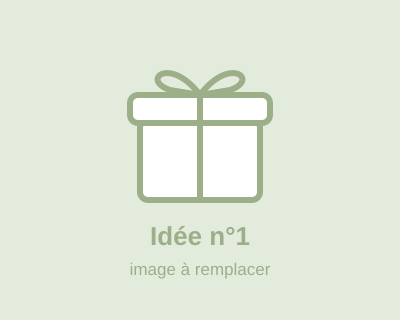

# Wishlist Noël 2026 🎄

Une page web pour montrer mes idées de cadeaux à la famille. Chacun peut **réserver** une idée pour éviter les doublons.

## Les fichiers

| Fichier | Rôle |
|---|---|
| `index.html` | Le contenu de la page (titre, idées, boutons) |
| `style.css` | Les couleurs, la police, la mise en page |
| `images/` | Les images des idées (à remplacer par les tiennes) |
| `reservations-google-apps-script.js` | Le petit script à coller dans Google Sheets pour partager les réservations |

## Modifier une idée

Dans `index.html`, chaque idée ressemble à ceci :

```html
<!-- ===== IDÉE 1 ===== -->
<article class="idee" data-id="1">
  <h3 class="idee-titre"><a href="https://www.exemple.com/plaid" target="_blank" rel="noopener">Un plaid tout doux</a></h3>
  
  <button class="bouton-reserver" type="button">Réserver</button>
</article>
```

- **Titre** : le texte entre `<a ...>` et `</a>`
- **Lien du cadeau** : l'adresse dans `href="..."`
- **Image** : l'adresse dans `src="..."`. Tu peux mettre un fichier du dossier `images/` (par exemple `images/plaid.jpg`) ou l'adresse d'une image sur internet (`https://...`).
- **Ajouter une idée** : copie un bloc `<article> ... </article>` entier et donne-lui un **nouveau** numéro dans `data-id`.
- **Supprimer une idée** : supprime son bloc `<article> ... </article>` entier.

⚠️ Ne change pas le `data-id` d'une idée déjà réservée : c'est ce numéro qui relie l'idée à sa réservation.

## Partager les réservations avec toute la famille (une seule fois, environ 5 minutes)

Si tu ne fais rien, une réservation n'est visible que sur le téléphone ou l'ordinateur de la personne qui a cliqué. Pour que tout le monde voie les mêmes réservations, on les enregistre dans un Google Sheet :

1. Va sur [sheets.google.com](https://sheets.google.com) et crée une **feuille vide** (nomme-la par exemple « Réservations Noël »).
2. Dans le menu, clique sur **Extensions → Apps Script**.
3. Efface tout le code qui s'y trouve, puis colle le contenu du fichier `reservations-google-apps-script.js`. Enregistre (icône disquette).
4. En haut à droite, clique sur **Déployer → Nouveau déploiement**.
   - Roue dentée à côté de « Sélectionner le type » → **Application Web**
   - « Exécuter en tant que » : **Moi**
   - « Qui peut accéder » : **Tout le monde**
   - Clique sur **Déployer**, puis autorise l'accès avec ton compte Google. Si un écran dit « Google n'a pas validé cette application », clique sur *Paramètres avancés → Accéder à … (non sécurisé)* : c'est normal, c'est ton propre script.
5. Copie l'**URL de l'application Web** (elle finit par `/exec`).
6. Dans `index.html`, cherche cette ligne et colle l'URL entre les guillemets :
   ```js
   const URL_RESERVATIONS = "https://script.google.com/macros/s/..../exec";
   ```

C'est tout ! Chaque réservation ajoute une ligne dans ta feuille Google (numéro de l'idée, date). Pour **libérer une idée**, supprime simplement sa ligne dans la feuille.

💡 Petite astuce pour ne pas te gâcher la surprise : évite d'ouvrir le Google Sheet 😉

### Bon à savoir
- Avant de réserver, le site demande une confirmation, pour éviter les clics par erreur.
- La personne qui a réservé une idée peut annuler sa réservation en cliquant de nouveau sur « Réservé ✓ », mais seulement depuis le même téléphone ou le même ordinateur. Les autres ne peuvent pas l'annuler.
- Si tu modifies le script plus tard, refais *Déployer → Gérer les déploiements → Modifier → Nouvelle version* pour garder la même URL.

## Mettre le site en ligne

Le plus simple : **GitHub Pages**. Dans le dépôt GitHub, va dans *Settings → Pages*, choisis la branche `main` et le dossier `/ (root)`, puis enregistre. Le site sera disponible à une adresse du type `https://<ton-pseudo>.github.io/my-first-website/`, à envoyer à la famille.
